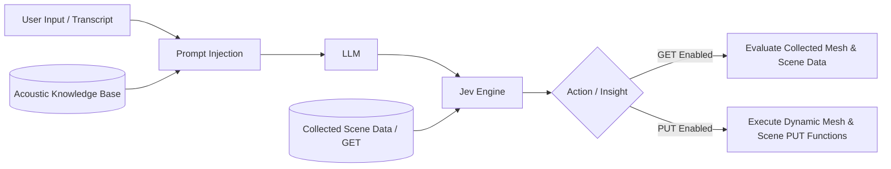

# 3D Audio Renderer: Jev AI Integration & Settings Design

## 1. Overview

This document outlines the system architecture, conversational workflow, and scene permissions settings menu for **Jev**, the embedded AI assistant within the 3D Audio Experience Renderer.

Jev enables users to dynamically inspect and modify acoustic environments using natural language. Depending on the permissions configured in the **Settings Menu**, Jev can read live scene states (`GET`), provide acoustic insights, and directly modify scene parameters (`PUT`).

## 2. System Workflow & Architecture

The pipeline translates user voice/text input into actionable 3D scene modifications by combining user intent with acoustic domain knowledge and dynamically collected scene context.

### Workflow Breakdown

1. **Transcript (User Input):** Captures the user's request (e.g., *"I want less echo"*).
2. **Domain Knowledge Injection:** System prompts inject acoustic rules and heuristics prior to LLM processing (e.g., `more meshes = less echo` or material absorption rules).
3. **LLM:** Parses the combined transcript and injected rules to determine user intent and required acoustic adjustments.
4. **Jev (Core Agent):** Receives the parsed intent alongside dynamically **Collected Scene Context** (governed by the Settings Menu).
   * **Dynamic Scene Evaluation (`GET`):** Jev reads the actual mesh counts, active mesh variants, and surface materials currently present in the scene data rather than relying on fixed presets.
   * **Insights vs. Actions (`PUT`):** If a parameter only has `GET` enabled, Jev provides **insights and suggestions** grounded in the collected scene metrics. If `PUT` is enabled, Jev executes **function calls** to dynamically adjust or switch to appropriate scene meshes and materials based on what is available in the collected data.

## 3. Settings Menu Specification (Scene Permissions)

The Settings Menu acts as the security and context boundary between the 3D Audio Renderer and **Jev**. Toggling these controls dictates what scene data is collected into Jev's context window and which properties Jev is permitted to mutate.

* **`GET` (Read / Insights):** Allows Jev to collect and inspect the current state and available options of a property in the 3D scene to give informed recommendations.
* **`PUT` (Write / Action):** Allows Jev to execute functions that actively modify the property in real time using collected scene data.

### A. Materials (`Materials - get`)

Jev can read the overall material composition of the room (`GET`) and, when permitted, apply specific acoustic surface materials (`PUT`) to alter sound reflection and absorption.

| Setting / Parameter | `GET` (Read) | `PUT` (Write) | Description / Behavior |
| :--- | :---: | :---: | :--- |
| **Materials (Global)** | ✅ | ❌ | Collects active surface materials across the scene for Jev's context. |
| **Wood** | ❌ | 🔘 Toggle | Permits Jev to assign wood acoustic properties to surfaces. |
| **Tiles** | ❌ | 🔘 Toggle | Permits Jev to assign reflective tile properties to surfaces. |
| **Concrete** | ❌ | 🔘 Toggle | Permits Jev to assign high-reflection concrete properties. |
| **Drywall** | ❌ | 🔘 Toggle | Permits Jev to assign standard drywall absorption properties. |

### B. Environment & Objects

Controls Jev's awareness and manipulation of architectural elements and spatial coordinates within the audio environment.

| Setting / Parameter | `GET` (Read) | `PUT` (Write) | Description / Behavior |
| :--- | :---: | :---: | :--- |
| **Windows** | 🔘 Toggle | 🔘 Toggle | Collect window states/positions or modify them (e.g., open/close/resize). |
| **Doors** | 🔘 Toggle | 🔘 Toggle | Collect door states/positions or modify them to alter sound occlusion. |
| **Speaker** | 🔘 Toggle | 🔘 Toggle | Collect audio source coordinates/properties or reposition/tune speakers. |
| **Location** | 🔘 Toggle | ❌ | Read-only access to static scene/room anchor coordinates. |
| **(User) Location** | 🔘 Toggle | 🔘 Toggle | Collect listener position/orientation or teleport/move the user in the scene. |

### C. Mesh Management

Governs geometric resolution and acoustic ray-tracing/diffraction fidelity based on the meshes collected from the active scene.

| Setting / Parameter | `GET` (Read) | `PUT` (Write) | Description / Behavior |
| :--- | :---: | :---: | :--- |
| **Mesh (Global)** | 🔘 Toggle | ❌ | Collects current mesh metrics and available mesh configurations from the scene. |
| **Mesh 1** | 🔘 Toggle | 🔘 Toggle | Read collected data or dynamically update geometry/resolution for mesh group 1. |
| **Mesh $N$** | 🔘 Toggle | 🔘 Toggle | Read collected data or dynamically update geometry/resolution for mesh group $N$. |

## 4. Example Execution Scenarios

### Scenario 1: Insight Only (`PUT` Disabled)
* **User Transcript:** *"I want less echo."*
* **Settings State:** `Materials: GET (On)`, `Mesh (Global): GET (On)`, `Mesh 1: GET (On) / PUT (Off)`
* **Jev Behavior:** Jev inspects the collected scene context—reading the current surface materials and active mesh metrics—and responds with an **insight**: *"Based on the current scene data, your room uses reflective concrete surfaces and is running on a lower-density mesh configuration. To reduce echo, try enabling `PUT` permissions for Drywall or allowing me to switch to a higher-density mesh available in your scene."*

### Scenario 2: Automated Action (`PUT` Enabled)
* **User Transcript:** *"I want less echo."*
* **Settings State:** `Mesh (Global): GET (On)`, `Mesh 1: GET (On) / PUT (On)`, `Drywall: PUT (On)`
* **Jev Behavior:** Using the injected rule (`more meshes = less echo`) and the mesh configurations discovered via `GET`, Jev dynamically selects a higher-density mesh from the collected scene data, triggers the corresponding `PUT` function to apply it, updates wall surfaces to drywall, and confirms the changes to the user.